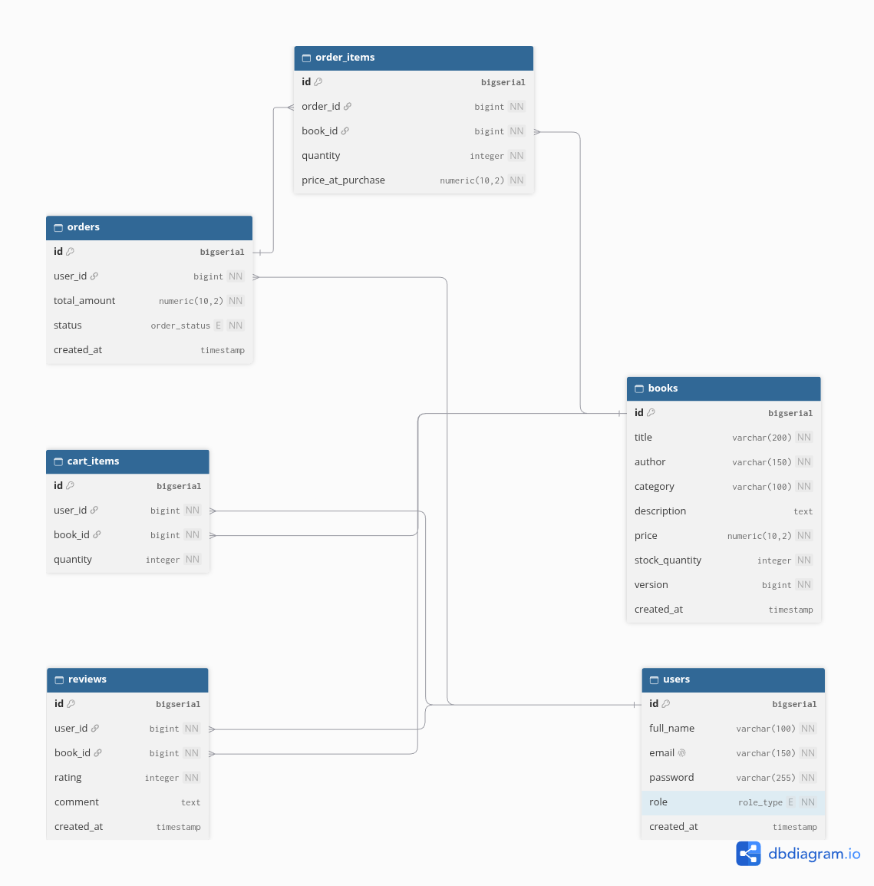

# virtual-bookstore 
## Database Design (PostgreSQL)

The relational schema models users, book inventory (with `@Version` optimistic locking), stateful shopping carts, immutable order snapshots (`price_at_purchase`), and customer reviews:

